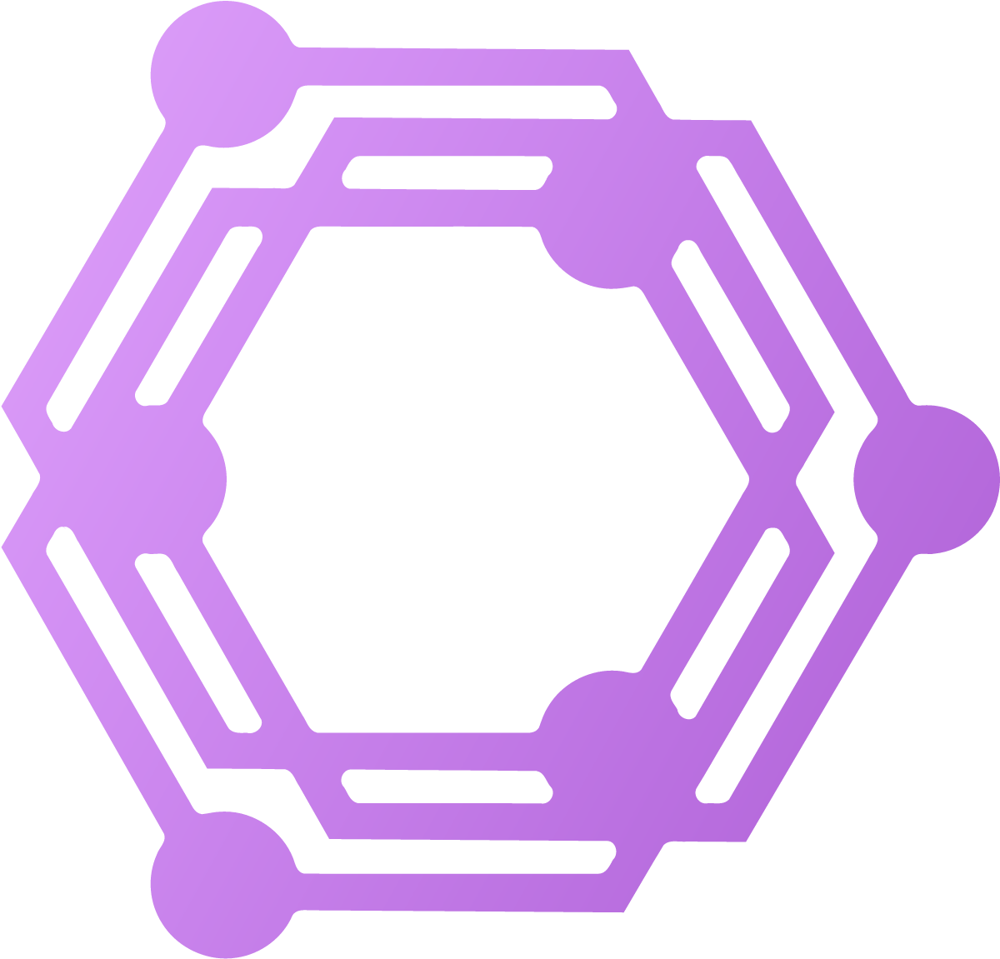

<p align="center">
  <a href="https://dose.wiki"></a>
</p>

<h1 align="center">dose.wiki</h1>

<p align="center"><em>An open encyclopedic database for the study of psychopharmacology</em><br><sub>v0.9 beta</sub></p>

This repository is the Next.js application behind dose.wiki and its Effect Index publication. PlanetScale Postgres is the runtime database. The protected `/dev` surface holds the editorial tools.

## About dose.wiki

**dose.wiki** synthesizes factual knowledge about psychoactive substances from harm-reduction and reference sources into a single open dataset. It aims to establish an open standard for psychopharmacology datasets, supporting research and education.

- **[Substance articles](https://dose.wiki/substances):** dose, duration, effects, interactions, chemistry, and legality by country.
- **[Subjective effect articles](https://dose.wiki/effects):** individual components of altered states, from [visual drifting](https://dose.wiki/effects/drifting) to [ego death](https://dose.wiki/effects/ego-death).
- **[Replications](https://dose.wiki/replications):** images, videos, and audio that recreate subjective effects.
- **[Trip reports](https://dose.wiki/reports):** first-person accounts of individual experiences.

### Sources and review

The factual knowledge within substance articles draw on decades of documentation by scientists, psychonauts, and the harm-reduction community, gathered from [ten harm-reduction and reference resources](https://dose.wiki/docs/how#sources). Each article links to the source pages that informed it.

Substance articles were drafted by LLMs, with dosage information transcribed by software from online tables. Real life human beings then reviewed and carefully edited each output over the course of months. The [how articles are made](https://dose.wiki/docs/how) explains the process in depth.

So, why did we use LLMs as part of this process? This was done for several reasons, but primarily speed, practicality, and reproducibility. Josie Kins, a co-founder of this project, the founder of PsychonautWiki, and numerous other similar projects, has real-world experience hand-crafting substance encyclopedias with teams of human beings. We know what it takes. It is an incredibly arduous and long term process. For example, the first draft of psychonautwiki took an entire community of people from 2011-2016. With incredibly few people reliably sticking around, and their workflows always leaving with them. Our community doesn't need a modern and open platform in 5 years from now. We need one yesterday.

This is why factual knowledge from across the internet was carefully scraped from online resources, assembled into either mechanistic parsers or an LLM synthesis pipeline, and aggregated into a single beautifully machine readable dataset, for anybody to download. A process that was followed by months of human review before we felt comfortable publishing it, and in total took about a year to complete. We deeply care about what we are doing here, and are now building as humans on top of this new open standard.

**dose.wiki is in beta.** Each article's **Article Status** section tracks its progress and identifies whether it has been human-reviewed. Review is essential to trustworthiness: reviewers verify pharmacology, check dosage and interactions for potentially harmful errors, and add corrections, references, and their own explanations. Errors can have serious real-world consequences, so we welcome anyone able to submit feedback via the forms at the bottom of each substance article!

The other collections are entirely human-created:

- **Effect articles** form the [Subjective Effect Index](https://dose.wiki/effects), written over more than a decade across several websites.
- **Replications** depict the subjective appearance of experiences through artwork, mostly by members of Reddit's [r/replications](https://reddit.com/r/replications) community.
- **Trip reports** are written by their authors and reviewed by an editor before publication.

The site and dataset continue to evolve toward 1.0. Check back for updates, or [send questions, comments, and corrections](https://dose.wiki/about#contact).

## Public routes

Public pages live under `src/app/`. Representative route groups are:

- library and articles: `/substances`, `/[slug]`, `/articles`, and `/articles/[slug]`;
- effects and reports: `/effects`, `/effects/[effectSlug]`, `/reports`, and `/reports/[slug]`;
- media: `/replications` and `/replications/[slug]`;
- discovery: `/category/[categoryKey]`, `/chemical-classes/[classKey]`, `/mechanism/[mechanismSlug]`, `/psychoactive/[...summaryPath]`, and `/search`;
- project pages: `/about`, `/contributors/[profileKey]`, `/docs/how`, `/docs/code`, and `/docs/license`.

Some pages are publication-specific. `src/config/siteFlavor.ts` defines the flavor contract, and `lib/next/flavorGatedRoutes.ts` enforces it. The `src/app/**/page.tsx` files are the current route map. Compatibility redirects and aliases live in `src/middleware.ts` and `lib/next/publicRouteAliases.ts`.

The routes above are live at <https://dose.wiki/> and <https://www.dose.wiki/>. Pre-launch `/preview` addresses permanently redirect to the matching unprefixed route.

### Public read-only API

The read-only API at <https://dose.wiki/api/v1> (OpenAPI 3.1 at
<https://dose.wiki/api/v1/openapi.json>) exposes substance records, normalized
reagent tests, molecule SVGs, and replication collections. The complete
consumer contract, including the canonical replication embed at
`/embed/replications` and its versioned message protocol, is
[docs/api.md](docs/api.md). Use OpenAPI rather than this README for paths and
response shapes.

DoseWiki content is for harm-reduction education and is not medical advice. Review the [license and reuse terms](https://dose.wiki/docs/license) and preserve source attribution.

## Editor surface

Sign in at `/sign-in`. The protected editor is mounted at `/dev` with tab and item deep links.

The editor groups related work rather than exposing separate applications:

- article work includes Substances, Review, Citations, Tags, and Index layout;
- intake and moderation include Trip reports, Feedback, and Site feedback;
- media tools include Molecules, Banners, and Replications;
- publication tools include Writing, Blog, Copy, and Contributors;
- Profile and Change log remain primary account and audit destinations.

`DEV_TAB_REGISTRY` in `src/features/dev/pages/devTabRegistry.ts` is the tab inventory. `src/features/dev/pages/DevModePageView.tsx` renders the tabs, and `src/features/dev/pages/devModePageUtils.ts` normalizes deep links.

### Authentication and writes

Auth.js supplies identity, and the Postgres `memberships` table supplies roles. [Auth](docs/architecture/auth.md) covers accounts, roles, and route protection. Editor tool handlers live under `src/app/api/dev/`. Article saves go through `src/app/api/save-article/`. Named rate-limit policies live in `lib/http/rateLimitPolicy.ts`.

## Develop

```bash
bun install --frozen-lockfile
bun run dev
```

[CONTRIBUTING.md](CONTRIBUTING.md) covers setup, local tools, and verification. [ARCHITECTURE.md](ARCHITECTURE.md) maps the repository, and [docs/README.md](docs/README.md) indexes the rest of the documentation. The visual codebase overview is at [`/docs/code`](https://dose.wiki/docs/code), and the article process is at [`/docs/how`](https://dose.wiki/docs/how).
